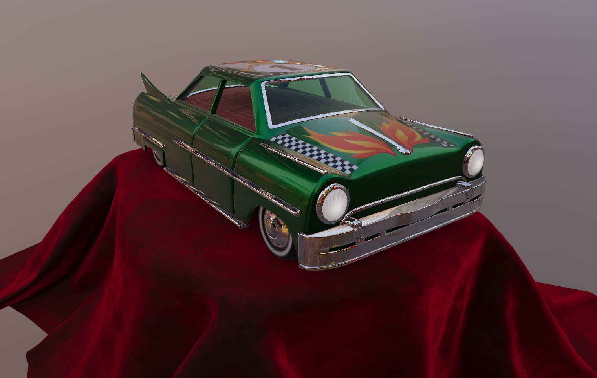

# Khronos glTF Sample Renderer

[](https://github.khronos.org/glTF-Sample-Viewer-Release/)

This is the official [Khronos glTF 2.0](https://www.khronos.org/gltf/) Sample Renderer using [WebGL](https://www.khronos.org/webgl/).

Try out the [glTF Sample Viewer](https://github.khronos.org/glTF-Sample-Viewer-Release/) which uses this renderer in combination with a custom frontend.

## Table of Contents

- [Khronos glTF Sample Renderer](#khronos-gltf-sample-renderer)
  - [Table of Contents](#table-of-contents)
  - [Credits](#credits)
  - [Features](#features)
  - [API](#api)
    - [GltfView](#gltfview)
    - [GltfState](#gltfstate)
      - [GraphController](#graphcontroller)
      - [AnimationTimer](#animationtimer)
      - [PhysicsController](#physicscontroller)
      - [Dirty flags](#dirty-flags)
        - [`AnimatableProperty` dirty flags](#animatableproperty-dirty-flags)
        - [Node transform dirty flags](#node-transform-dirty-flags)
        - [Resetting dirty flags](#resetting-dirty-flags)
    - [ResourceLoader](#resourceloader)
  - [Render Fidelity Tools](#render-fidelity-tools)
  - [Development](#development)
    - [Formatting](#formatting)
      - [Visual Studio Code](#visual-studio-code)
    - [Testing](#testing)
  - [Regression Testing](#regression-testing)

## Credits

Developed and refactored by [UX3D](https://www.ux3d.io/). Supported by the [Khronos Group](https://www.khronos.org/) and by [Google](https://www.google.com/) for the glTF Draco mesh compression import.
Formerly hosted together with the example frontend at the [glTF Sample Viewer](https://github.com/KhronosGroup/glTF-Sample-Viewer) repository. Original code based on the concluded [glTF-WebGL-PBR](https://github.com/KhronosGroup/glTF-Sample-Viewer/tree/glTF-WebGL-PBR) project. Previously supported by [Facebook](https://www.facebook.com/) for animations, skinning and morphing.
For KHR_interactivity, the behavior engine of the [glTF-InteractivityGraph-AuthoringTool](https://github.com/KhronosGroup/glTF-InteractivityGraph-AuthoringTool) is used.

## Features

- [x] glTF 2.0
- [KHR_accessor_float64](https://github.com/KhronosGroup/glTF/pull/2397)
    - [x] Animations
    - [x] KHR_animation_pointer
    - [ ] Mesh Attributes not supported since WebGL2 only supports 32 bit
    - [ ] Skins not supported since WebGL2 only supports 32 bit
- [x] [KHR_animation_pointer](https://github.com/KhronosGroup/glTF/tree/main/extensions/2.0/Khronos/KHR_animation_pointer)
- [x] [KHR_draco_mesh_compression](https://github.com/KhronosGroup/glTF/tree/main/extensions/2.0/Khronos/KHR_draco_mesh_compression)
- [x] [KHR_gaussian_splatting](https://github.com/KhronosGroup/glTF/blob/main/extensions/2.0/Khronos/KHR_gaussian_splatting/README.md)
- [x] [KHR_implicit_shapes](https://github.com/eoineoineoin/glTF_Physics/blob/master/extensions/2.0/Khronos/KHR_implicit_shapes/README.md)
- [x] [KHR_interactivity](https://github.com/KhronosGroup/glTF/pull/2293)
- [x] [KHR_lights_punctual](https://github.com/KhronosGroup/glTF/tree/main/extensions/2.0/Khronos/KHR_lights_punctual)
- [x] [KHR_materials_anisotropy](https://github.com/KhronosGroup/glTF/tree/main/extensions/2.0/Khronos/KHR_materials_anisotropy)
- [x] [KHR_materials_clearcoat](https://github.com/KhronosGroup/glTF/tree/main/extensions/2.0/Khronos/KHR_materials_clearcoat)
- [x] [KHR_materials_diffuse_transmission](https://github.com/KhronosGroup/glTF/blob/main/extensions/2.0/Khronos/KHR_materials_diffuse_transmission/README.md)
- [x] [KHR_materials_dispersion](https://github.com/KhronosGroup/glTF/tree/main/extensions/2.0/Khronos/KHR_materials_dispersion)
- [x] [KHR_materials_emissive_strength](https://github.com/KhronosGroup/glTF/tree/main/extensions/2.0/Khronos/KHR_materials_emissive_strength)
- [x] [KHR_materials_ior](https://github.com/KhronosGroup/glTF/tree/main/extensions/2.0/Khronos/KHR_materials_ior)
- [x] [KHR_materials_iridescence](https://github.com/KhronosGroup/glTF/tree/main/extensions/2.0/Khronos/KHR_materials_iridescence)
- [x] [KHR_materials_pbrSpecularGlossiness](https://github.com/KhronosGroup/glTF/tree/main/extensions/2.0/Khronos/KHR_materials_pbrSpecularGlossiness)
- [x] [KHR_materials_sheen](https://github.com/KhronosGroup/glTF/tree/main/extensions/2.0/Khronos/KHR_materials_sheen)
- [x] [KHR_materials_specular](https://github.com/KhronosGroup/glTF/tree/main/extensions/2.0/Khronos/KHR_materials_specular)
- [x] [KHR_materials_transmission](https://github.com/KhronosGroup/glTF/tree/main/extensions/2.0/Khronos/KHR_materials_transmission)
- [x] [KHR_materials_unlit](https://github.com/KhronosGroup/glTF/tree/main/extensions/2.0/Khronos/KHR_materials_unlit)
- [x] [KHR_materials_variants](https://github.com/KhronosGroup/glTF/tree/main/extensions/2.0/Khronos/KHR_materials_variants)
- [x] [KHR_materials_volume](https://github.com/KhronosGroup/glTF/tree/main/extensions/2.0/Khronos/KHR_materials_volume)
- [KHR_materials_volume_scatter](https://github.com/KhronosGroup/glTF/blob/e17468db6fd9ae3ce73504a9f317bd853af01a30/extensions/2.0/Khronos/KHR_materials_volume_scatter/README.md)
    - [x] For dense volumes using KHR_materials_diffuse_transmission
    - [ ] For sparse volumes using KHR_materials_transmission
- [x] [KHR_meshopt_compression](https://github.com/KhronosGroup/glTF/pull/2517)
- [x] [KHR_mesh_quantization](https://github.com/KhronosGroup/glTF/tree/main/extensions/2.0/Khronos/KHR_mesh_quantization)
- [x] [KHR_node_hoverability](https://github.com/KhronosGroup/glTF/pull/2426)
- [x] [KHR_node_selectability](https://github.com/KhronosGroup/glTF/pull/2422)
- [x] [KHR_node_visibility](https://github.com/KhronosGroup/glTF/pull/2410)
- [x] [KHR_physics_rigid_bodies](https://github.com/eoineoineoin/glTF_Physics/blob/master/extensions/2.0/Khronos/KHR_physics_rigid_bodies/README.md)\
    Supported Engines:
  - NVIDIA PhysX ([limitations](PhysicsEngines.md))
- [x] [KHR_texture_basisu](https://github.com/KhronosGroup/glTF/tree/main/extensions/2.0/Khronos/KHR_texture_basisu)
- [x] [KHR_texture_transform](https://github.com/KhronosGroup/glTF/tree/main/extensions/2.0/Khronos/KHR_texture_transform)
- [x] [KHR_xmp_json_ld](https://github.com/KhronosGroup/glTF/tree/main/extensions/2.0/Khronos/KHR_xmp_json_ld)
- [x] [EXT_mesh_gpu_instancing](https://github.com/KhronosGroup/glTF/tree/main/extensions/2.0/Vendor/EXT_mesh_gpu_instancing)
- [x] [EXT_meshopt_compression](https://github.com/KhronosGroup/glTF/tree/main/extensions/2.0/Vendor/EXT_meshopt_compression)
- [x] [EXT_texture_webp](https://github.com/KhronosGroup/glTF/tree/main/extensions/2.0/Vendor/EXT_texture_webp)

## API

glTF Sample Renderer is made to be integrated into web applications (see [glTF Sample Viewer](https://github.com/KhronosGroup/glTF-Sample-Viewer)) or to be used for automated testing (see [Render Fidelity Tools](#render-fidelity-tools)).

The API consists of several components that in combination allow flexible configuration of the glTF viewer.

More detailed information about the API is listed in the [api documentation](API.md).

### GltfView

The GltfView component is associated with one WebGL2 context. In practice this means it will be associated with one HTML5 Canvas. This component manages the interaction between the canvas and the GL context. It therefore specifies the viewport, the swapchain and can be used to schedule frame renders.

```js
const view = new GltfView(webGl2Context);
```

The view is also used to render frames, either on every window repaint event or on demand, e.g. when taking a frame capture.

```js
const update = () => {
    view.renderFrame(state, canvas.width, canvas.height);
    window.requestAnimationFrame(update);
};
window.requestAnimationFrame(update);
```

The GltfView handles the order of execution for animations, interactivity and physics:
1. Animations are applied
2. Any playing interactivity graph is executed
3. The transform hierarchy is computed
4. Any playing physics engine is updated and applied
5. The scene is rendered
6. If physics is used, all dirty flags are reset

### GltfState

The GltfState encapsulates the state of the content of a GltfView. _As currently some WebGL resources are stored directly in the Gltf objects, the state cannot be shared between views._

```js
const state = view.createState();
state.sceneIndex = 0;
state.animationIndices = [0, 1, 2];
state.animationTimer.start();
```

The state is passed to the `view.renderFrame` function to specify the content that should be rendered.

#### GraphController

The GltfState contains an instance of the GraphController which can be used to load and execute `KHR_interactivity` graphs. One can also send custom events to the graph or subscribe to custom event via callbacks.

In the GltfState you can define an array of selection and hover points. Each element of the array represents one controller. If `triggerSelection` is set to `true`, the renderer will return the picking result of the clicked position via `selectionCallback`. The interactivity engine will be notified as well, if `KHR_node_selectability` is used in the current glTF.

If `enableHover` is set to `true`, the renderer will return the picking result of the hovered position via `hoverCallback`. The interactivity engine receives hover results independent of `enableHover` based on the `hoverPositions` array. `enableHover` enables the use of custom hover handling independent of `KHR_interactivity` and is set to `false` by default.

To make sure that `KHR_interactivity` always behaves correctly together with `KHR_node_selectability` and `KHR_node_hoverability`, update the values in the `hoverPositions` and `selectionPositions` arrays and trigger selections via `triggerSelection`. Currently, only one controller is supported. All entries except the first one of each array are ignored. Arrays are used to enable multiple controllers in the future without breaking the API.

#### AnimationTimer

The GltfState contains an instance of the AnimationTimer, which is used to play, pause and reset animations. It needs to be started to enable animations.
The `KHR_interactivity` extension controls animations if present. Therefore, the GraphController uses the time of the AnimationTimer to control animations. The GraphController is paused and resumed independently from the AnimationTimer, thus if an interactivity graph is paused, currently playing animations will continue playing if the AnimationTimer is not paused as well.

#### PhysicsController

The GltfState contains an instance of the `PhysicsController`, which manages rigid-body physics simulation for glTF scenes that use the `KHR_physics_rigid_bodies` and `KHR_implicit_shapes` extensions. The controller is available on the state as `state.physicsController`.

Before loading any scene, the physics engine must be initialized. Currently only `"NvidiaPhysX"` is supported:

```js
await state.physicsController.initializeEngine("NvidiaPhysX");
```

After a glTF has been loaded, call `loadScene` to build the physics actors for the active scene:

```js
state.physicsController.loadScene(state, state.sceneIndex);
```

The simulation is advanced by calling `simulateStep` each frame inside `GltfView`. The controller uses a fixed-step accumulator and only advances the simulation when enough time (`simulationStepTime`, default `1/60` s) has elapsed.

Playback can be paused and resumed independently of other state:

```js
state.physicsController.pauseSimulation();
state.physicsController.resumeSimulation();
```

The `playing` property reflects whether the simulation is currently running, and `enabled` indicates whether the loaded scene contains any physics data.

Debug visualization of colliders and joints can be toggled at runtime:

```js
state.physicsController.enableDebugColliders(true);
state.physicsController.enableDebugJoints(true);
```

The following runtime physics operations are available, and are also called internally by the `KHR_interactivity` engine:

```js
// Apply a linear and/or angular impulse to a node
state.physicsController.applyImpulse(nodeIndex, linearImpulse, angularImpulse);

// Apply an impulse at a specific world-space position on a node
state.physicsController.applyPointImpulse(nodeIndex, impulse, position);

// Cast a ray and return the first hit
const hit = state.physicsController.rayCast(rayStart, rayEnd);
```

#### Dirty flags

Dirty flags are per-property boolean markers used to propagate change information through the scene graph without re-evaluating the entire hierarchy every frame. They are the primary mechanism by which animations, `KHR_interactivity`, and the physics simulation communicate what has changed.

##### `AnimatableProperty` dirty flags

Every animatable property defined by the glTF Object Model (e.g. `translation`, `rotation`, `scale`, `mass`, `linearVelocity`) is backed by an `AnimatableProperty` instance that carries a `dirty` boolean. A property is marked dirty whenever its value is written — either by the animation system or by the interactivity graph. It does not matter, if the written value is the same as the old value, since one can animate an e.g. a node transform to stay still. If the dirty flag would not be set in this case, the physics engine might apply e.g. gravitational forces to the an animated body.

##### Node transform dirty flags

Each `gltfNode` carries two additional boolean flags that are computed during `scene.applyTransformHierarchy()`:

| Flag | Set when |
|---|---|
| `node.dirtyTransform` | This node's local transform or any ancestor's transform changed since the last reset. |
| `node.dirtyScale` | This node's scale or any ancestor's scale changed since the last reset. |

##### Resetting dirty flags

`glTF.resetAllDirtyFlags()` performs a full reset in one call.

`GltfView.renderFrame()` calls this automatically at the end of each frame — but **only** when the physics simulation is either disabled or actively playing. When the simulation is paused, dirty flags are intentionally **not** cleared so that any changes made while paused (e.g. via `KHR_interactivity`) are still visible to the physics engine once playback resumes.

If you manually advance the simulation (e.g. via a single-step button) you must reset dirty flags yourself afterwards:

```js
state.physicsController.simulateStep(state, 1 / 60);
state.gltf.resetAllDirtyFlags();
```

### ResourceLoader

The ResourceLoader can be used to load external resources and make them available to the renderer.

```js
state.gltf = await resourceLoader.loadGltf("path/to/some.gltf");
```

## Render Fidelity Tools

The glTF Sample Renderer is integrated into Google's [render fidelity tools](https://github.com/google/model-viewer/tree/master/packages/render-fidelity-tools). The render fidelity tools allow the comparison of different renderers. To run the project follow the instructions [here](https://github.com/google/model-viewer/blob/master/README.md) and [here](https://github.com/google/model-viewer/blob/master/packages/render-fidelity-tools/README.md). For information on how the glTF Sample Renderer was integrated see the [pull request on Github](https://github.com/google/model-viewer/pull/1962).

## Development

After cloning this repository, run

```
npm install
```

to install all dependencies. To test and view your changes on a canvas, it is recommended to clone [glTF Sample Viewer](https://github.com/KhronosGroup/glTF-Sample-Viewer) which uses this renderer as a submodule.

`npm run build` will build the npm package and put the bundled code into the `dist` directory.

`npm run build_docs` will regenerate the [API documentation](API.md).

### Formatting

This repository uses [Prettier](https://prettier.io/) for code formatting and [ESLint](https://eslint.org/) for linting.

To check the formatting and linting of the code run:

```bash
npm run format
```

Prettier and ESLint are configured to only run on files in the "source" folder and ignore files in "source/libs".

#### Visual Studio Code

There are extensions for both Prettier and ESLint in Visual Studio Code. They can be found in the marketplace:

- [Prettier - Code formatter](https://marketplace.visualstudio.com/items?itemName=esbenp.prettier-vscode)
- [ESLint](https://marketplace.visualstudio.com/items?itemName=dbaeumer.vscode-eslint)

You are encouraged to run Prettier and ESLint on your code before committing.

## Regression Testing

The regression tests render models from [glTF-Sample-Assets](https://github.com/KhronosGroup/glTF-Sample-Assets) in headless Chromium and compare a candidate rendering against a previously rendered baseline. Renderings are not checked in, so baseline and candidate are always produced on the same machine and GPU.

Typical workflow:

```bash
git switch main
npm run regression:baseline   # render the reference images
git switch my-feature
npm run regression:compare    # render again and diff against the baseline
```

Both scripts run `npm run build` first. To skip the build, or to override options, call the runner directly:

```bash
node tests/regression/run.js --compare --models DamagedHelmet,BoxAnimated
```

| Option | Default | Description |
| --- | --- | --- |
| `--baseline` / `--compare` | | Required, exactly one. |
| `--models A,B` | `models` from the lock file, plus all local assets | Comma-separated model names from `model-index.json` or local asset names (`<folder>/<file>`). |
| `--width`, `--height` | `1920`, `1080` | Canvas size. Changing it requires a new baseline. |
| `--threshold` | `0.1` | Per-pixel color tolerance of [pixelmatch](https://github.com/mapbox/pixelmatch) (0 to 1). |
| `--max-diff-ratio` | `0.001` | Fraction of differing pixels above which a frame fails. |
| `--headed` | | Show the browser window. |

The exit code is `1` if any model fails or cannot be rendered.

### Assets

[tests/regression/assets.lock.json](tests/regression/assets.lock.json) pins glTF-Sample-Assets and the environment map ([glTF-Sample-Environments](https://github.com/KhronosGroup/glTF-Sample-Environments)) to fixed commits, so updates to the assets never show up as renderer regressions. `models` lists the models to render; set it to `null` to render every model of the index. Only the `glTF` variant is used; models without it are reported as errors.

`npm run regression:update-pin` moves both pins to the latest commit of their branch. Render a new baseline afterwards.

Assets are downloaded on first use and cached per commit.

`localAssets` lists folders, relative to the lock file, whose `.gltf` and `.glb` files are rendered as well. They are named `<folder name>/<file name without extension>`, e.g. `gaussian-splatting-tests/Blending`. [tests/regression/test-assets](tests/regression/test-assets) holds small checked-in assets for features not covered by glTF-Sample-Assets, currently `KHR_gaussian_splatting`.

### Rendering

Each model is loaded into [tests/regression/page/index.html](tests/regression/page/index.html), a full-size canvas using the built `dist/` package. All models are rendered sequentially in a single browser page that is reloaded per model, so memory use does not grow with the number of models.

The view matches the default of the glTF Sample Viewer: default scene, user camera fitted to the scene, Khronos PBR Neutral tone mapping and the Cannon Exterior environment. All animations that don't target the same properties are played and sampled every 250 ms over the longest animation, capped at 40 frames (10 s). Physics and `KHR_interactivity` graphs are not run. Before a frame is captured, rendering repeats until the Gaussian splat sort worker has finished (at most 10 s, otherwise the model is reported as an error).

### Output

Everything is written to the git-ignored `regression/` folder:

```
regression/
  environments/<commit>/Cannon_Exterior.hdr
  models/<commit>/
    model-index.json
    <model>/glTF/...
  renderings/
    summary.json
    <model>/
      t00000ms.baseline.png
      t00000ms.candidate.png
      t00000ms.diff.png
      t00250ms.baseline.png
      ...
```

`diff.png` shows the baseline faded out, differing pixels in red and anti-aliasing differences (which are not counted) in yellow.

`summary.json` records the pinned assets, resolution, tolerances, and per run (`baseline`, `candidate`) the renderer branch and commit, browser, GPU and totals. Per model it lists the status (`baseline`, `pass`, `fail`, `missing-baseline`, `error`), the animation duration, the sampled timepoints and every frame with its file paths and diff result, so no directory listing is needed to find the images. Browser console errors and failed requests are recorded per model as well.

A baseline run deletes the model's previous renderings. A compare run keeps the baseline and replaces candidates and diffs. If the asset pins or the resolution changed since the baseline, a compare run aborts and asks for a new baseline.
